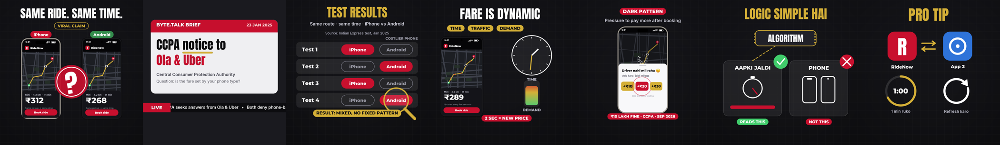

# free-ai-avatar-studio

**Make talking AI-character reels for free.** Start from one character image per scene and a voice-over. You get a
finished 1080x1920 Instagram Reel / YouTube Short / TikTok with lip sync, karaoke captions, animated B-roll graphics,
music, sound effects and a cover. Lip sync runs on **Kaggle's free T4 GPUs**. Everything else runs on your Mac or
Linux machine.



- **Lip sync, two ways (free GPU):**
  - **fast:** EchoMimicV3-Flash, both Kaggle T4s in parallel.
  - **realistic:** moving "takes" (background motion, blinks, expressions) from Wan2.1-Fun image-to-video, with the
    face pinned to your character image, then LatentSync 1.5 redraws only the mouth.
- **Captions from your exact script:** the script is force-aligned to the audio, never transcribed, so there are no
  misheard words. Captions run 2–4 words at a time, the spoken word pops in the highlight colour, and key words show
  in your accent colour. Hinglish and other romanized scripts work; write `[shown|spoken]` for words like
  `[₹10 lakh|das lakh]`.
- **Graphics in code:** animated B-roll and overlays drawn with cairo, with a reusable toolkit (titles, pills, phone
  mockups, maps, stamps, ✓/✗ marks). The character stays visible in a face-tracked circle while graphics play.
- **A camera that feels filmed:**
  - 30 fps via RIFE interpolation
  - colour grade per scene
  - handheld drift (plus road vibration in vehicles)
  - 115% punch-ins centred on the tracked face
  - grain, vignette and an end freeze
- **Sound in code:**
  - a synthesised lo-fi/trap bed (or your own track), ducked under the voice
  - whooshes on cuts, cues on events, a music drop before your twist line
  - mastered to -14 LUFS
- **One `project.json`, word-anchored:** every time is written as a word ("B-roll starts at *Indian*"), so a
  re-recorded voice-over re-times the whole edit.

**Kaggle notebooks:** [Fast Lip Sync](https://www.kaggle.com/code/sahilempire/free-ai-avatar-studio-fast-lip-sync) · [Realistic Lip Sync](https://www.kaggle.com/code/sahilempire/free-ai-avatar-studio-realistic-lip-sync). Open one, click **Copy & Edit**, and add your kit as input.

## How it works

```
your Mac / Linux                                        Kaggle (free T4 x2)
-------------------------------------------            ---------------------------------------------
studio align     exact script -> word timings
studio timeline  anchors -> scenes, B-roll, cues
studio kit       VO -> chunks + images -> kit.zip ----> lipsync_fast.ipynb       (clips.zip)
                                                         or lipsync_realistic.ipynb (takes.zip)
studio track     camera track (grade, motion, 30 fps) <--- unzip into work/clips or work/takes
studio captions | audio | broll
studio render    final .mp4 + cover.png
```

## Quick start

1. **Install (macOS or Linux).**
   - System packages first:
     - macOS: `brew install ffmpeg python@3.11 cairo pkg-config`
     - Linux: `sudo apt install ffmpeg python3-venv libcairo2-dev pkg-config libvulkan1`
   - Then:
     ```bash
     git clone https://github.com/sahilempire/free-ai-avatar-studio && cd free-ai-avatar-studio
     ./setup.sh && source .venv/bin/activate
     ```
2. **Make a project.**
   - Copy `examples/cab-fare/` to a new folder.
   - Put your scene images and `voiceover.wav` in its `assets/`.
   - Edit `project.json`: scenes, script, key words, brand, B-roll anchors.
   - Write your graphics in `broll.py` (see below).
3. **Prepare the kit:** `studio prep -p project.json` (align, timeline, kit). This writes `work/kit.zip`.
4. **Lip sync on Kaggle:**
   - Upload `work/kit.zip` as a **private** dataset.
   - Import `kaggle/lipsync_fast.ipynb` (or `lipsync_realistic.ipynb`) and add the dataset as input.
   - Set GPU **T4 x2**, Internet **On**, then **Run All**.
   - Unzip the output into `work/clips/` (fast) or `work/takes/` (realistic). Full steps: [docs/kaggle.md](docs/kaggle.md).
5. **Finish locally:** `studio post -p project.json`. For realistic takes, run
   `studio post --source scenes -p project.json` instead. The finished reel is in `out/`.

## Fast vs realistic

| | fast (EchoMimicV3-Flash) | realistic (moving takes + LatentSync 1.5) |
|---|---|---|
| Background | mostly still | moves (traffic, lights, people) |
| Face | animated photo | blinks, glances, expression changes; mouth redrawn to the voice |
| Kaggle GPU time, 60 s reel | ~1.5 h (two GPUs) | ~20 min per take (2 per scene) + ~1.2 min per second of speech |
| Re-use | per reel | takes are a library: render once per scene, dub every new voice-over |

Kaggle's free tier is 30 GPU-hours a week. A daily reel fits with the fast notebook. With realistic, render the take
library once and only dub after that.

## project.json in one minute

```jsonc
{
  "voiceover": "assets/voiceover.wav",
  "scenes": [ {"id": "street", "image": "assets/street.png", "grade": "night_neon", "ambience": "street", "prompt": "..."},
              {"id": "cab", "image": "assets/cab.png", "start": {"word": "Maamla", "offset": -0.2}, "vibration": true} ],
  "script": {"language": "hin", "lines": ["[iPhone|aai phone] hai? ..."], "key_words": ["iphone", "case closed"]},
  "broll": {"module": "broll.py",
            "pieces":   [{"id": "B3_results_board", "from": {"word": "Indian", "offset": -0.1}, "to": {"word": "Kyunki"},
                          "events": {"row1": {"word": "Indian", "offset": 0.3}}}],
            "overlays": [{"id": "S1_fine_stamp", "from": {"word": "₹10 lakh"}, "to": {"word": "Booking"}}]},
  "punch_ins": [{"from": {"word": "Case"}, "to": {"word": "closed", "edge": "end", "offset": 0.2}}],
  "sfx": [{"at": {"word": "₹10 lakh"}, "kind": "thud"}],
  "music": {"bpm": 92, "drop_before": {"word": "Real"}},
  "freeze": {"from": {"word": "Comment"}, "hold_after": 0.75},
  "brand": {"accent": "#C8102E", "highlight": "#D4AF37", "ink": "#0E0E10", "watermark": "your.handle", "follow": "Follow @your.handle"},
  "ai_disclosure": {"enabled": true}
}
```

Anchors can take these forms:
- `{"word": w, "nth": n, "edge": "start"|"end", "offset": s}`
- `{"scene": id}`
- `{"event": "piece.event"}`
- `"vo_end"`
- plain seconds

Grades: `neutral`, `night_neon`, `daylight`, `studio_red_rim`, `golden_hour`. SFX kinds: `whoosh`, `whoosh_soft`,
`kaching`, `tick`, `thud`, `click`.

## Writing graphics

`broll.py` defines `DRAW = {"piece_id": fn}`. Each `fn(c, t, piece)` draws one frame with cairo:
- `t` is the absolute time.
- `piece` holds `start`, `end` and the resolved `events`.

Import the toolkit with `from studio.draw import *`. Keep important content between y=230 and y=1080:
- The top 220 px and bottom 380 px sit under Instagram's UI.
- Captions sit at about y=1190.
- The character's circle sits bottom-left.

Preview any frame: `studio broll --still B3_results_board 28.9`.

## Responsible use

- Use characters you created or have consent for. Don't impersonate real people, and don't present AI content as
  real footage of a real person.
- Disclose AI content where your platform requires it. `ai_disclosure` adds an on-screen label; Instagram and TikTok
  also have their own AI labels.
- Check every on-screen claim. The example frames its viral claim as a claim and cites sources.
- Follow the model licenses in [CREDITS.md](CREDITS.md). **The caption aligner's model is non-commercial
  (CC-BY-NC-4.0).**

## Docs

- [docs/kaggle.md](docs/kaggle.md): step-by-step Kaggle runs and the GPU budget.
- [docs/lessons.md](docs/lessons.md): every failure we hit on free T4s and the fix that's now built in.
- [examples/cab-fare](examples/cab-fare): the full example (a 64 s Hinglish explainer), minus the character
  images and voice-over.

MIT © Sahil Gupta, [sahilempire.com](https://sahilempire.com). Third-party models keep their own licenses, listed in
[CREDITS.md](CREDITS.md).
